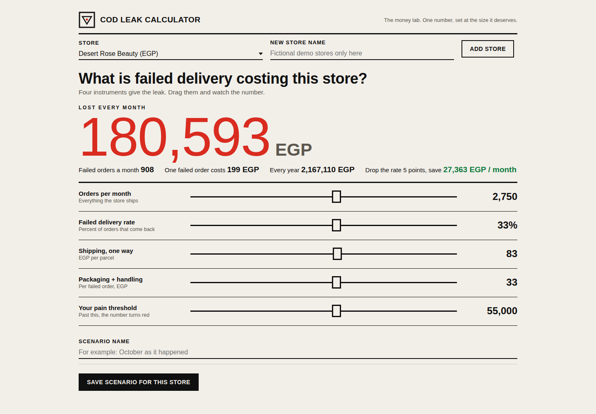

# COD Leak Calculator

A calculator that shows a store owner what failed deliveries cost, in their own numbers: orders per month, failure rate, shipping cost both ways, packaging. It started as one static page. It is now a small local app, because a number an owner saw once and forgot changes nothing, while a scenario they saved and can compare against next month does.

Default example: 1,000 orders, 25% failed, 65 per parcel one way, 15 packaging. That is 250 failed orders a month, 145 per failed order, and a 36,250 monthly leak, for a problem most stores describe as "normal".

## Run it

```bash
cd backend
python3 seed.py
python3 app.py
```

Open http://127.0.0.1:8084 and sign in with a demo account, owner / demo1234 or analyst / demo1234. Both are demo accounts for a local demo, printed here on purpose. Change them before the app holds anything real.

## What it does

- The original calculator, live in the page: failed orders, cost per failed order, monthly and yearly leak, and the saving from a five point drop in the failure rate (capped at the failures that actually exist)
- Saved scenarios per store, with full create, read, update and delete through the API. A store cannot hold two scenarios with the same name, the app refuses the second one instead of quietly overwriting
- A comparison view: tick scenarios and get a table plus an inline SVG bar chart of monthly losses side by side
- A history list of the most recently touched scenarios across all stores
- CSV import of scenarios per store (`backend/sample_scenarios.csv` is a working example), with a rejection report that names every refused row, its row number and why: duplicates inside the file, names the store already has, and malformed numbers are all rejected, never silently merged
- A backup endpoint (`GET /api/backup`) that exports stores, scenarios and user accounts as JSON, with password hashes and salts deliberately left out
- A printable report view (Print report button) that prints the comparison chart and table on a clean page

## Architecture

Python 3 standard library only, no packages to install. The backend in `backend/app.py` is a small REST API over SQLite, passwords stored as PBKDF2 hashes, every route except login and health behind a bearer token, all SQL parameterised. The frontend in `frontend/index.html` is a kinetic-type money lab (see DESIGN.md) and talks to that API only. It runs locally, there is no public deployment of this version, and the old static page now lives at `frontend/index.html` as the app's only page.

## Configuration

The app reads its settings from the environment; `config.env.example` lists them:

| Variable | Default | Meaning |
|---|---|---|
| `COD_LEAK_PORT` | `8084` | Port the server listens on |
| `COD_LEAK_DB` | `backend/cod_leak.db` | SQLite database path |
| `COD_LEAK_LOG` | `backend/app.log` | App log file, logins and imports are recorded there |
| `COD_LEAK_TOKEN_TTL` | `28800` | Login token lifetime in seconds |

## Tests

```bash
python3 tests/test_api.py
```

Twenty six checks against a scratch seeded database on a test port: auth failures (no token, forged token, wrong password), the original calculator maths on a seeded scenario, scenario CRUD including the duplicate name conflict, comparison ordering, CSV import duplicate and malformed rejection, the backup contents, deletion, the served frontend, and the log file.

## Known limitations

Tokens live in server memory, so a restart signs everyone out. There is one currency label per store and no conversion between stores, comparisons across stores with different currencies are shown as saved and not converted. The import expects the exact header in the documented order of names, and there is no password change or user management screen; the two seeded accounts are the whole user system for now. Seed stores, scenarios, names and numbers are fictional.

## Screenshots



The money lab with the sliders parked mid-range: the monthly leak set
at the size of a door, already red because it crossed the pain
threshold. All data on this screen is fictional demo data.
